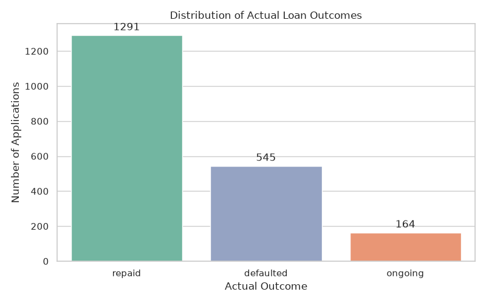
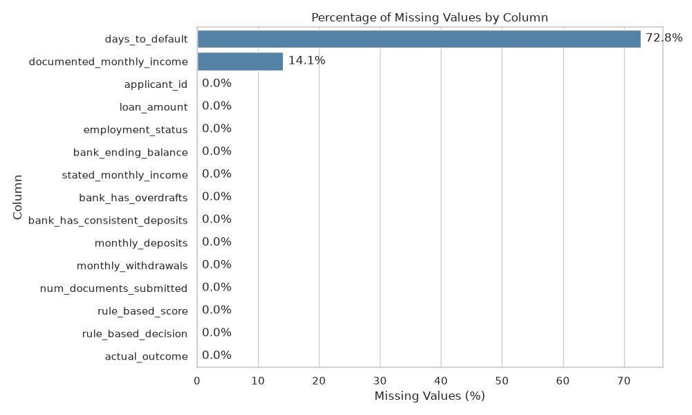
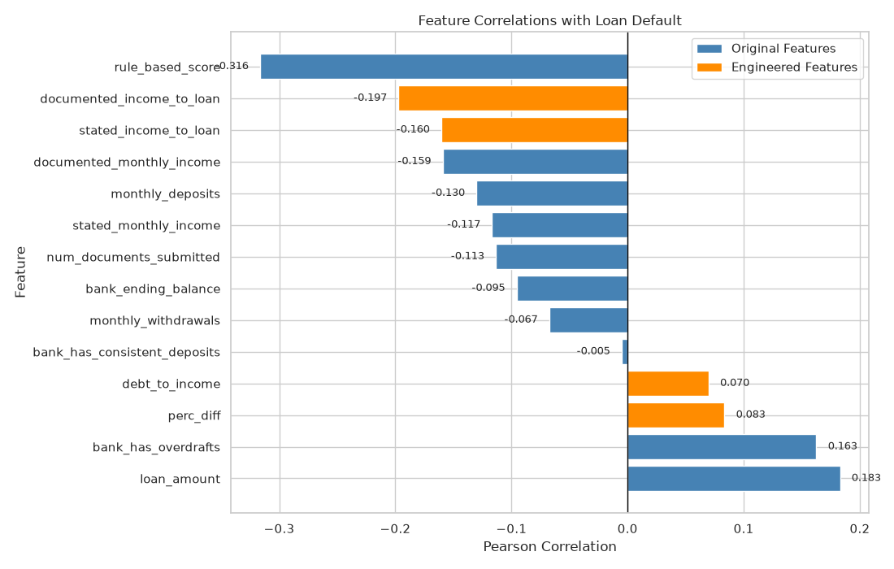
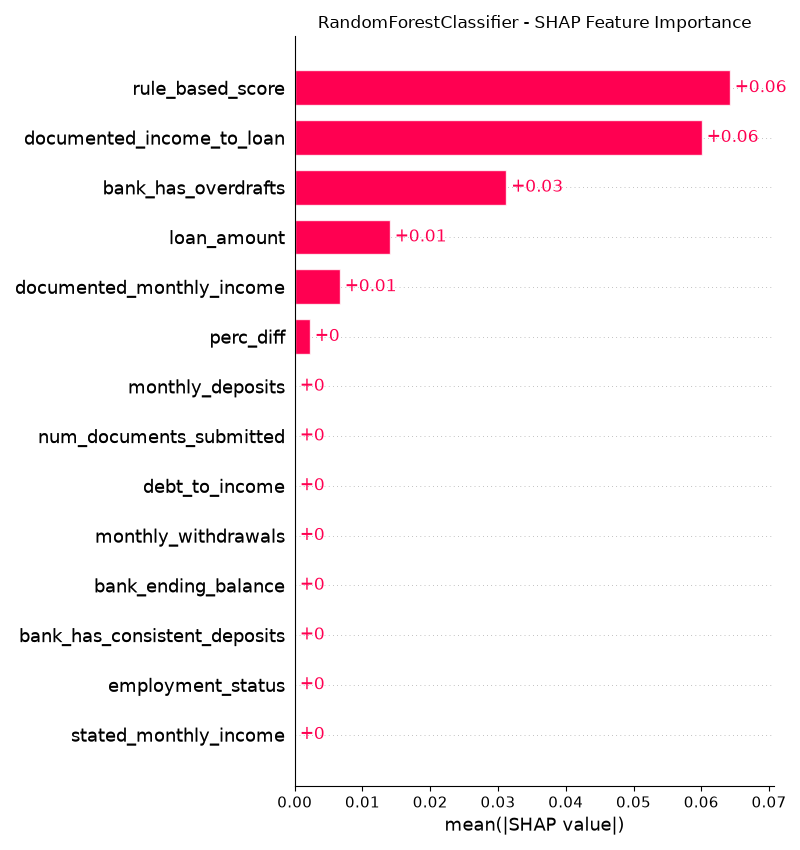
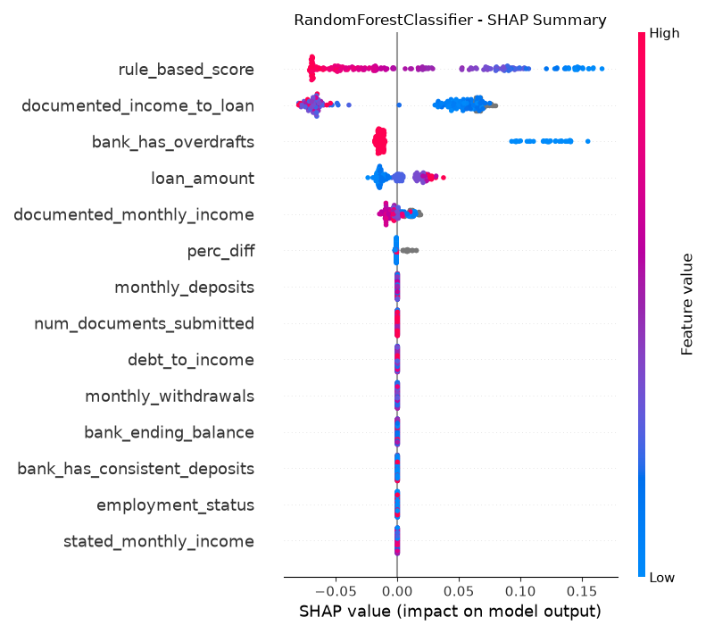
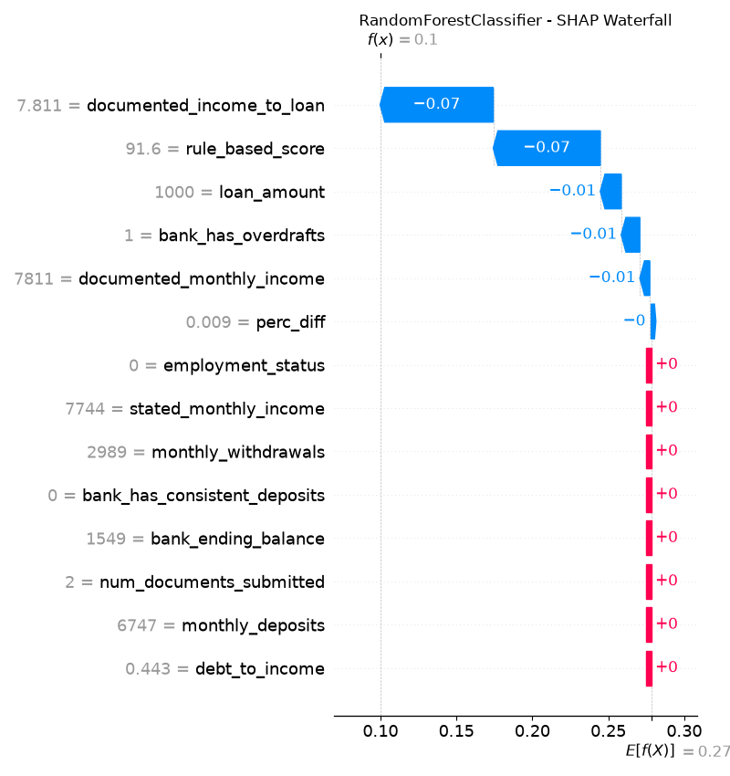
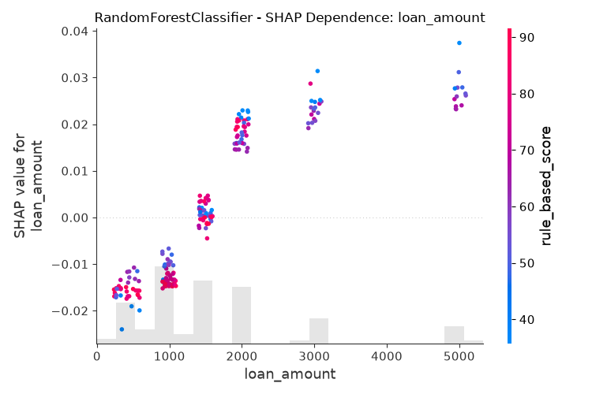
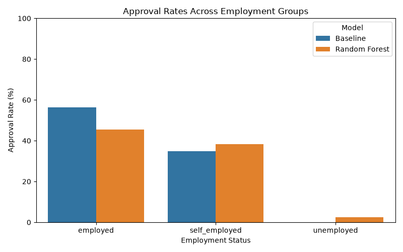

### Data Handling

The first thing that stood out in the data was that there was a large imbalance between "repaid" and "defaulted" data samples:

To handle the imbalance, I experimented with changing the class weightings during training as well as using a prediction probability threshold of 0.45 instead of the default 0.5 during inference.

Another thing that stood out was that two columns had missing data:

In particular, `days_to_default` only applies to defaulted loans. Furthermore, since `days_to_default` cannot be known without already knowing the outcome of a loan, it should not be used as an input feature. Thus, this column was discarded altogether from the data.

On the other hand, `documented_monthly_income` is actually quite promising as an input feature as shown in the following correlation plot:

Thus, it would be better to keep this as a feature in the data. To handle the missing values, I used a median imputer to fill in the missing values based on the rest of the trainin data. However, since this may create issues with inter-feature relationships, such as documented vs. stated monthly income, I also set up the imputer to mark the new data as originally missing.

Rows corresponding to ongoing applications were discarded from the data. The reasoning for this is as follows:

1) Ongoing applications cannot be used as data for an outcome predictor since the outcome of an ongoing application is unknown.

2) Ongoing applications make up only ~8% of the data so it will be relatively safe to discard them.

However, it is important to note that this may introduce some degree of selection bias. For example, since repaid loans would typically be expected to last longer than defaulted loans, excluding ongoing applications could disproportionately remove loans that would eventually have been repaid.

### Model and features

In the model comparison, all models (logistic regression, random forest, XGBoost, multi-layer perceptron) all achieved comparable performances on the test data.

However, since random forests and XGBoost are tree-based models, they possess more inherent explainability than the other two models. Between random forest and XGBoost, the random forest performed better in all metrics on the test data.

Thus, the final choice of model was a random forest.

In the SHAP analysis, the `rule_based_score` was the most important feature. This makes sense as it is essentially carefully engineered feature that contains prior knowledge of loanee patterns.

SHAP plots (after feature selection):

This is consistent with the Pearson correlation analysis where it was found that `rule_based_score` exhibited the highest absolute correlation with defaulted loans.

### Results and tradeoffs

#### 1. Overall Performance Comparison

| Metric | Baseline (review = repaid) | Baseline (review = defaulted) | Random Forest (class_weight=None) | Random Forest (class_weight="balanced") | Improvement |
|---|---:|---:|---:|---:|---:|
| Accuracy | 0.74 | 0.60 | **0.76** | 0.59 | +0.02 |
| Precision | 0.62 | 0.41 | **0.67** | 0.41 | +0.05 |
| Recall | 0.33 | 0.78 | 0.39 | **0.84** | +0.06 |
| F1-Score | 0.43 | 0.54 | 0.50 | **0.55** | +0.01 |

On the test data, each version of the random forest outperforms the corresponding baseline in all metrics (except the balanced class weight forest on accuracy). The largest increase was in the recall (class-balanced random forest). This would mean that the model would give less false negatives. I.e., it is less likely to approve a loan that would end up being defaulted. 

While there is a tradeoff in that it has less accuracy and precision. Whether this is worth it depends on  the application: minimize the number of falsely approve default loans (high recall) vs. minimize the number of falsely denied repaid loans (high precision).

### Fairness

From the graph, we can see that the random forest is reducing the bias in employed vs. self-employed approval rate compared to the baseline. Due to the similarity in results of employed vs. self-employed loans, I would recommend experimenting with merging employed and self-employed into a single category, so that it is now just employed vs. unemployed.

### Production risk

For the class-balanced random forest:

Since this one has much lower precision, I would expect a possible issue being reliable loan applicants getting wrongfully rejected. Thus, the next step for improvement would be improving precision, but not at the cost (to some degree of tolerance) of recall.